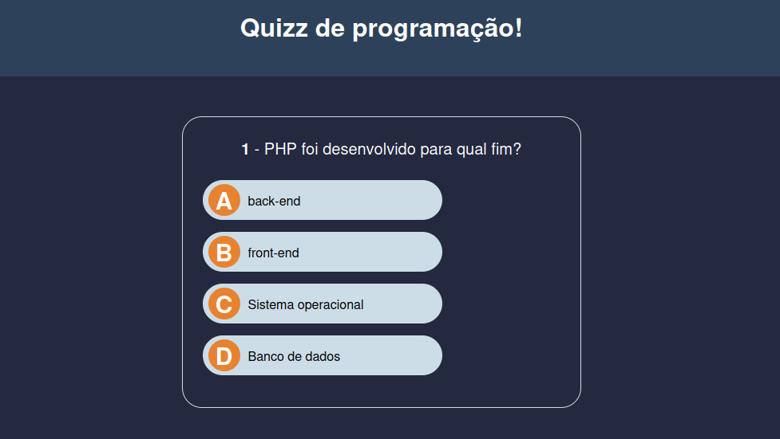

# Quizz JS

## Como funciona

**Quizz JS** é uma aplicação web simples de perguntas e respostas sobre programação. O projeto foi criado com HTML, CSS e JavaScript puro, sem frameworks ou dependências externas.

Seu principal intuito é praticar a manipulação do **DOM (Document Object Model)** com JavaScript e compreender como tornar uma página mais dinâmica e interativa. Em vez de deixar todas as perguntas prontas no HTML, a aplicação cria e atualiza os elementos da interface conforme o usuário interage com o quiz.

O fluxo da aplicação é:

1. A primeira pergunta e suas alternativas são inseridas na página.
2. O usuário seleciona uma alternativa.
3. A alternativa correta fica verde e as incorretas ficam vermelhas.
4. A pontuação é atualizada quando a resposta selecionada está correta.
5. Após 1,5 segundo, a próxima pergunta é exibida.
6. Ao responder todas as perguntas, a tela do quiz é substituída por uma tela com o resultado.
7. O botão **Refazer quizz!** reinicia as perguntas e a pontuação.

Atualmente, o quiz contém três perguntas sobre PHP, JavaScript e CSS, com quatro alternativas para cada uma.


## Como executar

### Pré-requisitos

Não é necessário instalar Node.js, bibliotecas ou qualquer outra dependência. Basta ter um navegador web moderno.

### Execução local

1. Clone este repositório ou baixe os arquivos do projeto.
2. Abra o arquivo `index.html` em um navegador.

Também é possível utilizar uma extensão de servidor local, como o Live Server do Visual Studio Code, para abrir o projeto em `http://localhost`.

## Exemplo de uso

Ao abrir a aplicação, uma pergunta é apresentada com quatro alternativas. Depois de selecionar uma opção:

- a resposta correta é destacada em verde;
- as respostas incorretas são destacadas em vermelho;
- a próxima pergunta aparece automaticamente após um pequeno intervalo.

Quando o usuário termina o quiz, a aplicação exibe:

- a porcentagem de aproveitamento;
- a quantidade de respostas corretas;
- a quantidade total de perguntas;
- um botão para começar novamente.

Para adicionar ou alterar perguntas, edite o array `questions` no arquivo [`js/scripts.js`](./js/scripts.js). Cada pergunta deve possuir um texto e uma lista de respostas, sendo que somente uma resposta deve ter `correct: true`.

Exemplo de estrutura:

```js
{
  question: "Qual tecnologia é usada para estilizar páginas web?",
  answers: [
    { answer: "HTML", correct: false },
    { answer: "CSS", correct: true },
    { answer: "SQL", correct: false },
    { answer: "Git", correct: false },
  ],
}
```

## Estrutura do código

```text
quizz-js/
├── index.html       # Estrutura da página e template das alternativas
├── css/
│   └── styles.css   # Estilos, estados das respostas e responsividade
├── js/
│   └── scripts.js   # Perguntas, lógica do quiz e manipulação do DOM
├── LICENSE          # Licença do projeto
└── README.md        # Documentação
```

### `index.html`

Define a estrutura inicial da aplicação:

- título do quiz;
- área da pergunta atual;
- container das alternativas;
- tela de pontuação, inicialmente oculta;
- template de botão usado para criar cada alternativa dinamicamente.

O atributo `defer` no carregamento do JavaScript permite que o HTML seja processado antes da execução do script.

### `js/scripts.js`

Concentra o comportamento da aplicação:

- seleciona elementos do HTML com `querySelector`;
- armazena as perguntas e respostas em objetos e arrays;
- clona o template de alternativa com `cloneNode`;
- atualiza textos e atributos usando `textContent` e `setAttribute`;
- adiciona e remove classes CSS com `classList`;
- registra eventos de clique com `addEventListener`;
- controla a pergunta atual e a pontuação;
- exibe o resultado final e reinicia o quiz.

As principais funções são:

- `init()`: inicia o quiz na primeira pergunta;
- `createQuestion(i)`: remove alternativas antigas e cria as alternativas da pergunta atual;
- `checkAnswer(btn)`: identifica a resposta correta, aplica os estilos e soma pontos;
- `nextQuestion()`: aguarda 1,5 segundo e avança ou finaliza o quiz;
- `showSuccessMessage()`: calcula e exibe o resultado;
- `hideOrShowQuizz()`: alterna a visibilidade entre o quiz e a tela de pontuação.

### `css/styles.css`

Define o visual da aplicação, incluindo:

- cores, espaçamentos, bordas e tipografia;
- estados visuais de resposta correta e incorreta;
- classe `.hide` para ocultar elementos;
- layout responsivo para telas menores.

## Conhecimentos desenvolvidos

- **HTML:** criação da estrutura semântica da página e uso de um elemento como template reutilizável.
- **CSS:** estilização de componentes, estados visuais e responsividade com media query.
- **JavaScript:** variáveis, arrays, objetos, funções, condicionais, laços e temporizadores.
- **Manipulação do DOM:** seleção, criação, clonagem, atualização, remoção e alteração de elementos HTML.
- **Eventos:** uso de `addEventListener` para reagir às escolhas do usuário e ao clique de reinício.
- **Controle de estado:** gerenciamento da pergunta atual e da pontuação durante a execução.
- **Git e GitHub:** uso básico das ferramentas de versionamento e colaboração, comuns no mercado.

## Limitações conhecidas

- As perguntas estão fixas no código JavaScript e não são carregadas de uma API ou banco de dados.
- O quiz possui somente três perguntas e espera quatro alternativas por pergunta.
- Cada pergunta deve conter exatamente uma resposta correta para que a pontuação funcione como esperado.
- Não há persistência da pontuação após fechar ou atualizar a página.
- Não há autenticação, ranking ou armazenamento de resultados.
- O usuário pode clicar em mais de uma alternativa antes de a próxima pergunta aparecer, pois o botão selecionado não é desabilitado durante o intervalo de 1,5 segundo.
- A aplicação depende de um navegador com suporte a recursos modernos de JavaScript e DOM.

## Ideias de evolução

- Permitir adicionar, remover e editar perguntas por uma interface própria.
- Carregar perguntas de uma API ou arquivo JSON externo.
- Embaralhar a ordem das perguntas e das alternativas.
- Desabilitar as alternativas após a primeira seleção.
- Exibir uma barra de progresso ou um cronômetro por pergunta.
- Criar diferentes categorias e níveis de dificuldade.
- Salvar o melhor resultado com `localStorage`.
- Adicionar acessibilidade aprimorada, incluindo navegação por teclado e mensagens para leitores de tela.
- Criar uma tela inicial para o usuário escolher a categoria e a quantidade de perguntas.
- Adicionar testes automatizados para validar a pontuação e o fluxo de navegação.
